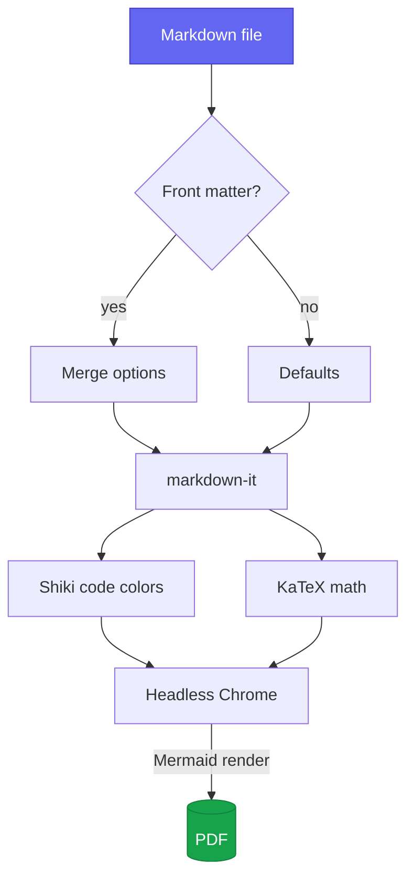
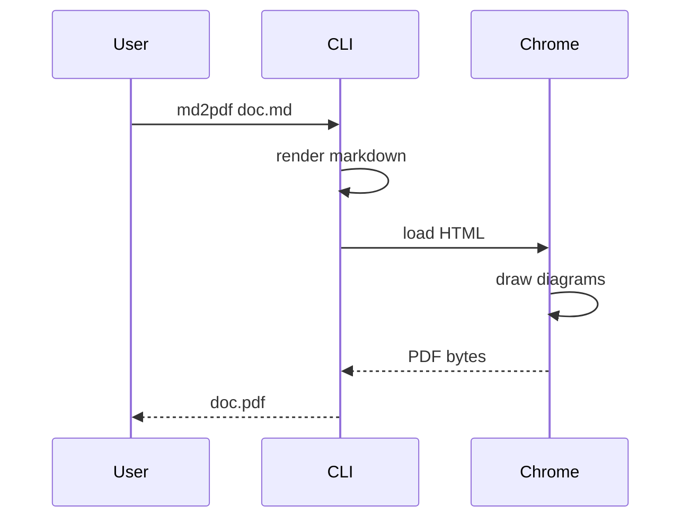
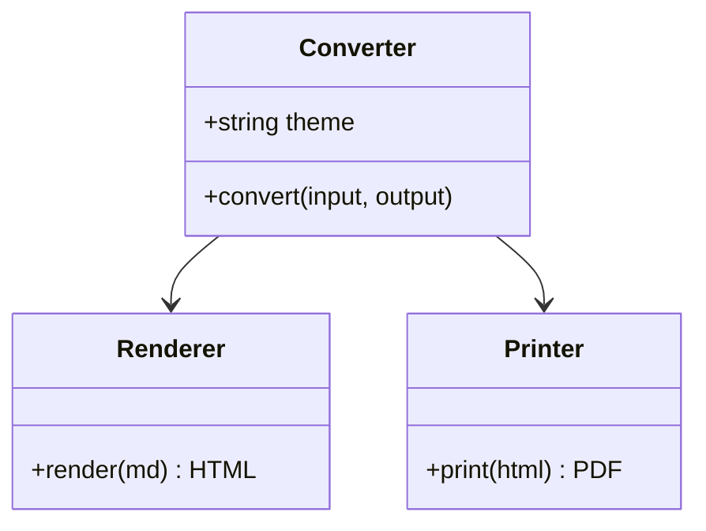
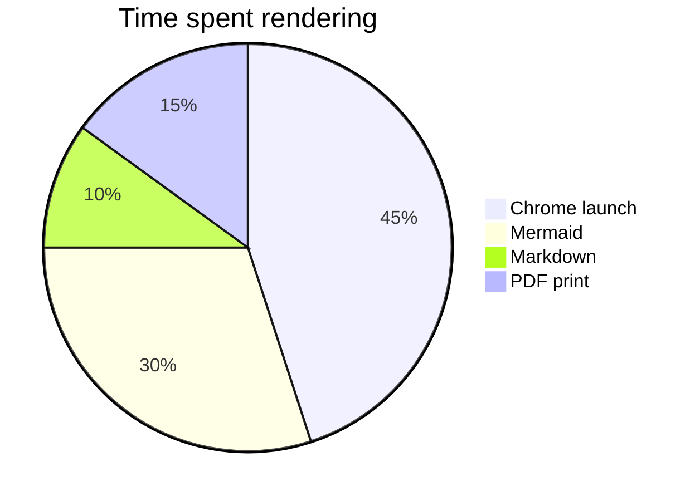
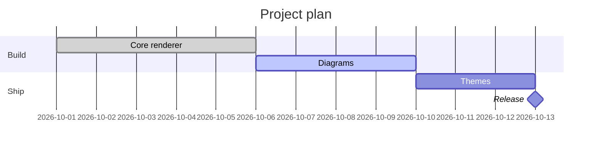
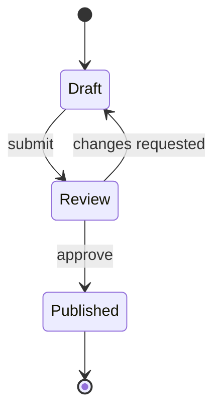
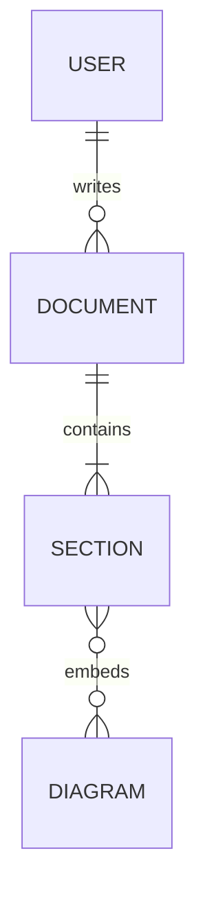
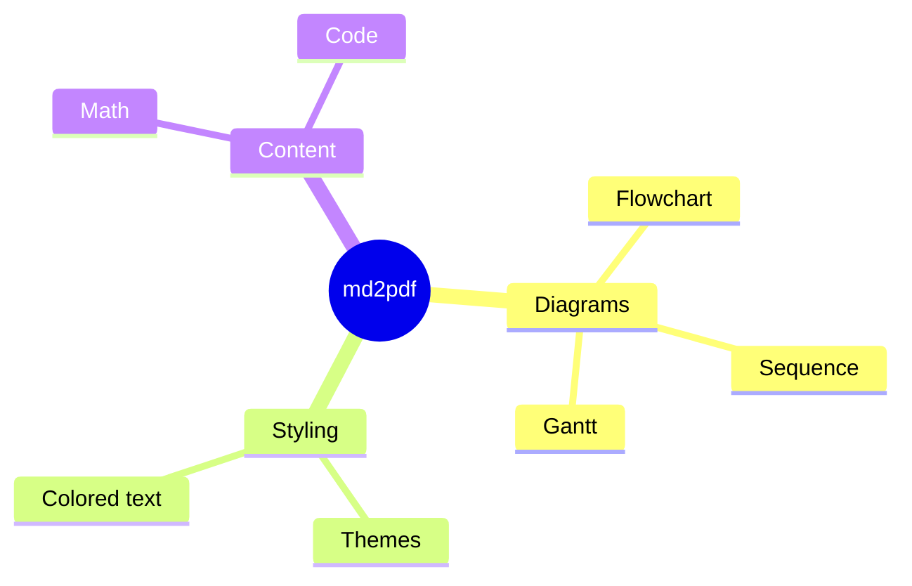

# md2pdf Showcase

A tour of everything **md2pdf** renders: {blue bold}(colored text), ==highlights==, diagrams, math, code and callouts.

## Colored Text

Shorthand syntax: {red}(red), {orange}(orange), {yellow}(yellow), {green}(green), {teal}(teal), {blue}(blue), {purple}(purple), {pink}(pink) and {gray}(gray).

Hex colors work too: {#ff6600}(custom orange) and {#0ea5e9 bold}(bold sky blue).

Backgrounds: {white bg:red}(DANGER), {bg:yellow}(attention), {white bg:#16a34a}(PASSED), {white bg:blue bold}(v2.0).

Nested markdown inside color: {purple}(this has **bold**, *italic* and `code`).

Attribute syntax: [blue and bold]{.blue .bold}, [inline style]{style="color:#e11d48"}, and raw HTML <span style="color:teal">also works</span>.

Text styles: ~~strikethrough~~, ==marked text==, and a footnote[^1].

[^1]: Footnotes are collected at the end of the document.

## Callouts

> [!NOTE]
> Useful information that users should know, even when skimming.

> [!TIP]
> Helpful advice for doing things better or more easily.

> [!IMPORTANT]
> Key information users need to know to achieve their goal.

> [!WARNING]
> Urgent info that needs immediate user attention to avoid problems.

> [!CAUTION]
> Advises about risks or negative outcomes of certain actions.

## Diagrams

### Flowchart



### Sequence



### Class diagram



### Pie chart



### Gantt



### State machine



### Entity relationship



### Mindmap



## Math

Inline math: the famous $E = mc^2$ and Euler's identity $e^{i\pi} + 1 = 0$.

Block math:

$$
\int_{-\infty}^{\infty} e^{-x^2}\,dx = \sqrt{\pi}
$$

$$
\mathbf{A} = \begin{pmatrix} a_{11} & a_{12} \\ a_{21} & a_{22} \end{pmatrix},
\qquad
\sum_{n=1}^{\infty} \frac{1}{n^2} = \frac{\pi^2}{6}
$$

## Code

```javascript
// Convert a file from Node
import { convert } from 'md2pdf';

await convert('README.md', 'README.pdf', { theme: 'dark', toc: true });
console.log(`Done in ${performance.now().toFixed(0)} ms`);
```

```python
from dataclasses import dataclass

@dataclass
class Page:
    number: int
    title: str = "Untitled"

    def label(self) -> str:
        return f"{self.number}: {self.title}"
```

```bash
md2pdf docs/*.md --theme sepia --toc
```

Inline `code` looks like this.

## Tables

| Feature        | Syntax                    | Status                     |
| -------------- | ------------------------- | -------------------------- |
| Colored text   | `{red}(text)`             | {white bg:green}(done)     |
| Diagrams       | ` ```mermaid `            | {white bg:green}(done)     |
| Math           | `$x^2$`                   | {white bg:green}(done)     |
| Interactive    | n/a                       | {white bg:gray}(PDF only)  |

## Lists

- [x] Parse markdown
- [x] Render diagrams
- [ ] Take over the world

1. First {green}(step)
2. Second step
   - nested bullet
   - another one
3. Third step

---

*Generated with md2pdf.*
